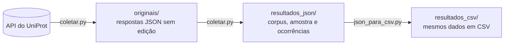

# Corpus de descrições biofísico-químicas de proteínas


Corpus de textos do **UniProt (Swiss-Prot)** que descrevem como a atividade ou a estabilidade de proteínas depende do **pH** e da **temperatura**. Cada descrição é guardada exatamente como aparece na fonte, junto com a proteína, a sequência, as evidências e a posição de onde foi retirada. Isso torna cada linha rastreável até o registro original.

O corpus foi pensado para estudos futuros de processamento de linguagem natural. Nesta etapa, o trabalho é coletar, organizar, conferir e descrever os dados. Não há treinamento de modelos nem previsão de propriedades.

| Proteína | Organismo | Categoria | Texto original |
| --- | --- | --- | --- |
| A0A023I7E1 | *Rhizomucor miehei* | `ph_dependence` | Optimum pH is 5.5. |
| A0A023I7E1 | *Rhizomucor miehei* | `temperature_dependence` | Optimum temperature is 50 degrees Celsius. |

<sub>Trecho real, reduzido a 4 das 11 colunas. As duas linhas são duas descrições da mesma proteína.</sub>

---

## Início rápido

```bash
pip install requests
python codigo/coletar.py        # pergunta quantas descrições: um número (ex.: 100) ou max
python codigo/json_para_csv.py  # gera as versões em CSV
```

- **Um número** grava `resultados_json/corpus_amostra.jsonl` com essa quantidade de descrições.
- **`max`** percorre todas as páginas da consulta e grava `resultados_json/corpus.jsonl` com todas as descrições.

As páginas já baixadas ficam em `originais/` e são reaproveitadas. Se a conexão cair, basta rodar de novo para continuar de onde parou.

## Como funciona



1. O `coletar.py` consulta a API do UniProt, página por página, e salva cada resposta sem nenhuma alteração em `originais/`.
2. A partir desses arquivos, extrai os textos dos campos **pH Dependence** e **Temperature Dependence**. **Cada elemento textual vira uma linha.** Uma proteína com uma descrição de pH e uma de temperatura gera duas linhas. Um texto com várias frases continua sendo uma linha só.
3. Casos com problema, como registros sem identificador, sem sequência ou com texto inválido, não são descartados em silêncio: vão para `ocorrencias.jsonl`, com o motivo e a decisão tomada.
4. O `json_para_csv.py` converte os resultados para CSV e relê cada arquivo para confirmar que o conteúdo é idêntico ao JSONL.

## Estrutura do repositório

```
├── codigo/
│   ├── coletar.py            coleta e extração
│   ├── json_para_csv.py      conversão para CSV
│   └── documentacao.txt      documentação detalhada do código
├── originais/                respostas do UniProt, sem edição
│   ├── coleta.json           consulta, datas, versão do UniProt e páginas baixadas
│   └── pagina_0001.json …
├── resultados_json/
│   ├── corpus_amostra.jsonl  amostra (primeira entrega)
│   ├── corpus.jsonl          corpus completo
│   ├── ocorrencias.jsonl     casos separados para conferência
│   └── extracao.json         contagens da última execução
└── resultados_csv/           os mesmos arquivos em CSV
```

## Critérios de inclusão

- **Consulta:** `reviewed:true AND cc_bpcp:*`, ou seja, registros revisados do Swiss-Prot com alguma anotação de propriedade biofísico-química.
- **Recorte:** entram apenas os textos dos campos `phDependence` e `temperatureDependence`. Parâmetros cinéticos e outras propriedades ficam de fora.
- **Sem filtro biológico:** não há restrição de espécie, família de proteínas ou tipo de enzima. Entram descrições de atividade, estabilidade ou qualquer outra observação presente nesses dois campos.
- **Exclusões:** registros sem texto em nenhum dos dois campos são deixados de fora e contados em `extracao.json`.
- **Ocorrências:** descrições sem identificador, sem sequência ou com conteúdo que não é texto são separadas em `ocorrencias.jsonl`.
- **Repetições:** textos iguais em proteínas diferentes permanecem no corpus.
- **Evidências:** as evidências da fonte são preservadas. Um registro revisado não significa que todas as afirmações foram demonstradas experimentalmente, por isso o corpus não é tratado como "dados experimentais".

## Colunas

| Coluna | Conteúdo |
| --- | --- |
| `description_id` | Identificador único nesta coleta: `accession` + `:` + `source_path` |
| `accession` | Identificador principal do UniProt (ex.: `A0A023I7E1`) |
| `organism` | Nome científico do organismo, quando disponível |
| `sequence` | Sequência de aminoácidos do registro, sem alterações |
| `entry_version` | Versão individual do registro (diferente da versão do banco) |
| `property_type` | `ph_dependence` ou `temperature_dependence` |
| `text_original` | Texto exatamente como aparece na fonte |
| `text_normalized` | Mesmo texto, só com espaços e quebras de linha padronizados |
| `evidences` | Evidências ligadas àquela descrição (lista vazia se não houver) |
| `source_file` | Arquivo de origem em `originais/` |
| `source_path` | Posição do texto no registro (ex.: `comments[3].phDependence.texts[0]`) |

No CSV, a lista de evidências aparece como texto JSON dentro da célula.

## Dados da coleta

| | |
| --- | --- |
| Consulta | `reviewed:true AND cc_bpcp:*` |
| Fonte | `https://rest.uniprot.org/uniprotkb/search` |
| Versão do UniProt | _preencher com `versao_uniprot` de `originais/coleta.json`_ |
| Data da versão | _preencher com `data_versao` de `originais/coleta.json`_ |
| Início da coleta | _preencher com `inicio` de `originais/coleta.json`_ |

## Reprodutibilidade

Com a coleta completa, rodar os dois scripts de novo refaz toda a organização a partir de `originais/`, sem acessar a internet. O resultado deve ser idêntico byte a byte. Para conferir, compare a assinatura do arquivo antes e depois:

```bash
python -c "import hashlib;print(hashlib.sha256(open('resultados_json/corpus.jsonl','rb').read()).hexdigest())"
```

Uma nova consulta ao site pode trazer registros atualizados. Por isso, a referência da coleta são sempre os arquivos salvos em `originais/`.

## Limitações

- **Não é uma tabela de medidas.** Os textos não foram convertidos em valores numéricos padronizados, e o corpus ainda não está dividido em treino e teste.
- **A amostra não é aleatória.** Ela segue a ordem dos identificadores e não representa a distribuição das proteínas no UniProt.
- **A sequência é a do registro.** O texto pode se referir a uma variante, um domínio ou outra forma da proteína.
- **Ausência de anotação não é ausência da propriedade.** Uma proteína sem descrição de pH pode simplesmente não ter sido estudada nesse aspecto.
- **Contagens diferentes.** O número de registros retornado pela busca não é o número de descrições do corpus.

## Estado do trabalho

- [x] Coleta e extração automatizadas
- [x] Amostra de 100 descrições (63 proteínas: 59 de pH e 41 de temperatura), sem ocorrências
- [ ] Corpus completo
- [ ] Conferência manual de 20 descrições (`conferencia.csv`)
- [ ] Resumo e gráficos (`resumo.csv`)
- [ ] Relatório (`relatorio.md`)

## Documentação

Os detalhes de cada função, das ocorrências, das contagens e dos testes realizados estão em [`codigo/documentacao.txt`](codigo/documentacao.txt).

## Fonte e licença dos dados

Os dados vêm do [UniProt](https://www.uniprot.org), distribuído sob a licença [Creative Commons Attribution 4.0 (CC BY 4.0)](https://www.uniprot.org/help/license). Ao reutilizar este corpus, dê crédito ao UniProt e informe a versão usada, registrada em `originais/coleta.json`.