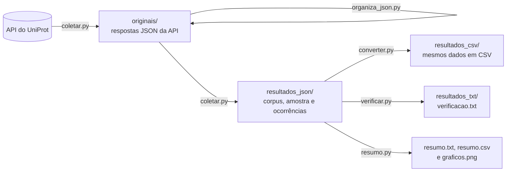

# Corpus de descrições biofísico-químicas de proteínas


Corpus de textos do **UniProt (Swiss-Prot)** que descrevem como a atividade ou a estabilidade de proteínas depende do **pH** e da **temperatura**. Cada descrição é guardada exatamente como aparece na fonte, junto com a proteína, a sequência, as evidências e a posição de onde foi retirada. Isso torna cada linha rastreável até o registro original.

O corpus foi pensado para estudos futuros de processamento de linguagem natural. Nesta etapa, o trabalho é coletar, organizar, conferir e descrever os dados. Não há treinamento de modelos nem previsão de propriedades.

| Proteína | Organismo | Categoria | Texto original |
| --- | --- | --- | --- |
| A0A023I7E1 | *Rhizomucor miehei* | `ph_dependence` | Optimum pH is 5.5. |
| A0A023I7E1 | *Rhizomucor miehei* | `temperature_dependence` | Optimum temperature is 50 degrees Celsius. |

<sub>Trecho real, reduzido a 4 das 11 colunas. As duas linhas são duas descrições da mesma proteína.</sub>

---

## Início rápido

```bash
pip install requests matplotlib
cd codigo
python coletar.py        # pergunta "Descrições:": responda um número (ex.: 100) ou max
python organiza_json.py  # formata os arquivos de originais/ para leitura
python converter.py      # gera as versões em CSV
python verificar.py      # confere o corpus com os arquivos originais
python resumo.py         # gera o resumo e os gráficos
```

Os scripts podem ser rodados de dentro de `codigo/` ou da raiz do projeto, com `python codigo/coletar.py`. Em qualquer caso, os dados ficam na raiz, ao lado de `codigo/`.

- **Um número** baixa só as páginas necessárias e grava `resultados_json/corpus_amostra.jsonl` com essa quantidade de descrições.
- **`max`** percorre todas as páginas da consulta.

Nos dois casos, `resultados_json/corpus.jsonl` guarda todas as descrições extraídas das páginas baixadas até o momento. Depois do `max`, são todas as descrições da consulta.

As páginas já baixadas ficam em `originais/` e são reaproveitadas. Se a conexão cair, basta rodar de novo para continuar de onde parou. As páginas novas chegam numa linha só, então rode o `organiza_json.py` de novo depois de cada coleta.

## Como funciona



1. O `coletar.py` consulta a API do UniProt, página por página, e salva cada resposta em `originais/` exatamente como chegou.
2. O `organiza_json.py` reescreve esses arquivos com quebras de linha e recuo, para que possam ser lidos e conferidos. Só a formatação muda: antes de substituir cada arquivo, o script confere que o conteúdo continua idêntico ao recebido da API.
3. A partir desses arquivos, o `coletar.py` extrai os textos dos campos **pH Dependence** e **Temperature Dependence**. **Cada elemento textual vira uma linha.** Uma proteína com uma descrição de pH e uma de temperatura gera duas linhas. Um texto com várias frases continua sendo uma linha só.
4. Casos com problema, como registros sem identificador, sem sequência ou com texto inválido, não são descartados em silêncio: vão para `ocorrencias.jsonl`, com o motivo e a decisão tomada.
5. O `converter.py` gera as versões em CSV e relê cada arquivo para confirmar que o conteúdo é idêntico ao JSONL.
6. O `verificar.py` confere cada linha com o registro original: identificador único, campos preenchidos, texto, sequência, organismo, evidências e categoria iguais à fonte. Também confirma que extrair de novo as páginas salvas reproduz o corpus.
7. O `resumo.py` conta registros, descrições, proteínas e organismos, calcula o comprimento mediano dos textos, lista os textos mais repetidos e desenha os gráficos.

## Estrutura do projeto

Este repositório guarda o código e a documentação. As pastas de dados não são versionadas aqui: elas são criadas ao rodar os scripts, e os arquivos da coleta entregue são enviados à parte.

```
├── codigo/
│   ├── coletar.py            coleta e extração
│   ├── organiza_json.py      formatação dos arquivos de originais/
│   ├── converter.py          conversão para CSV
│   ├── verificar.py          verificações gerais
│   ├── resumo.py             resumo e gráficos
│   └── documentacao.txt      documentação detalhada do código
├── originais/                respostas do UniProt, com o conteúdo sem edição
│   ├── coleta.json           consulta, datas, versão do UniProt e páginas baixadas
│   └── pagina_0001.json …
├── resultados_json/
│   ├── corpus_amostra.jsonl  amostra (primeira entrega)
│   ├── corpus.jsonl          todas as descrições das páginas baixadas
│   ├── ocorrencias.jsonl     casos separados para conferência
│   └── extracao.json         contagens da última execução
├── resultados_csv/           os mesmos arquivos em CSV, mais resumo.csv
├── resultados_txt/           verificacao.txt e resumo.txt
└── resultados_graficos/
    └── graficos.png          descrições por categoria e comprimento dos textos do corpus
```

## Critérios de inclusão

- **Consulta:** `reviewed:true AND cc_bpcp:*`, ou seja, registros revisados do Swiss-Prot com alguma anotação de propriedade biofísico-química.
- **Recorte:** entram apenas os textos dos campos `phDependence` e `temperatureDependence`. Parâmetros cinéticos e outras propriedades ficam de fora.
- **Sem filtro biológico:** não há restrição de espécie, família de proteínas ou tipo de enzima. Entram descrições de atividade, estabilidade ou qualquer outra observação presente nesses dois campos.
- **Exclusões:** registros sem texto em nenhum dos dois campos são deixados de fora e contados em `extracao.json`.
- **Ocorrências:** descrições sem identificador, sem sequência ou com conteúdo que não é texto são separadas em `ocorrencias.jsonl`.
- **Repetições:** textos iguais em proteínas diferentes permanecem no corpus.
- **Evidências:** as evidências da fonte são preservadas. Um registro revisado não significa que todas as afirmações foram demonstradas experimentalmente, por isso o corpus não é tratado como "dados experimentais".

## Colunas

| Coluna | Conteúdo |
| --- | --- |
| `description_id` | Identificador único nesta coleta: `accession` + `:` + `source_path` |
| `accession` | Identificador principal do UniProt (ex.: `A0A023I7E1`) |
| `organism` | Nome científico do organismo, quando disponível |
| `sequence` | Sequência de aminoácidos do registro, sem alterações |
| `entry_version` | Versão individual do registro (diferente da versão do banco) |
| `property_type` | `ph_dependence` ou `temperature_dependence` |
| `text_original` | Texto exatamente como aparece na fonte |
| `text_normalized` | Mesmo texto, só com espaços e quebras de linha padronizados |
| `evidences` | Evidências ligadas àquela descrição (lista vazia se não houver) |
| `source_file` | Arquivo de origem em `originais/` |
| `source_path` | Posição do texto no registro (ex.: `comments[3].phDependence.texts[0]`) |

No CSV, a lista de evidências aparece como texto JSON dentro da célula.

## Dados da coleta

| | |
| --- | --- |
| Consulta | `reviewed:true AND cc_bpcp:*` |
| Fonte | `https://rest.uniprot.org/uniprotkb/search` |
| Versão do UniProt | 2026_03 |
| Data da versão | 02-September-2026 |
| Início da coleta | _preencher com `inicio` de `originais/coleta.json`_ |

## Reprodutibilidade

Com a coleta completa, rodar `coletar.py` (respondendo `max`), `converter.py`, `verificar.py` e `resumo.py` de novo refaz toda a organização a partir de `originais/`, sem acessar a internet. O `verificar.py` confirma que a reextração reproduz o corpus e registra o resultado em `resultados_txt/verificacao.txt`. As contagens do resumo devem permanecer iguais.

A formatação feita pelo `organiza_json.py` não altera esse resultado, porque o conteúdo dos arquivos continua o mesmo.

Uma nova consulta ao site pode trazer registros atualizados. Por isso, a referência da coleta são sempre os arquivos salvos em `originais/`.

## Limitações

- **Não é uma tabela de medidas.** Os textos não foram convertidos em valores numéricos padronizados, e o corpus ainda não está dividido em treino e teste.
- **A amostra não é aleatória.** Ela segue a ordem dos identificadores e não representa a distribuição das proteínas no UniProt.
- **A sequência é a do registro.** O texto pode se referir a uma variante, um domínio ou outra forma da proteína.
- **Ausência de anotação não é ausência da propriedade.** Uma proteína sem descrição de pH pode simplesmente não ter sido estudada nesse aspecto.
- **Contagens diferentes.** O número de registros retornado pela busca não é o número de descrições do corpus.

## Estado do trabalho

- [x] Coleta e extração automatizadas
- [x] Amostra de 100 descrições (63 proteínas: 59 de pH e 41 de temperatura), sem ocorrências
- [x] Verificações gerais, resumo e gráficos automatizados
- [ ] Conferência manual de 20 descrições da amostra (`conferencia.csv`)
- [ ] Corpus completo
- [ ] Conferência manual de 20 descrições do corpus completo
- [ ] Relatório (`relatorio.md`)

## Documentação

Os detalhes de cada script, das verificações, das ocorrências, das contagens e dos testes realizados estão em [`codigo/documentacao.txt`](codigo/documentacao.txt).

## Fonte e licença dos dados

Os dados vêm do [UniProt](https://www.uniprot.org), distribuído sob a licença [Creative Commons Attribution 4.0 (CC BY 4.0)](https://www.uniprot.org/help/license). Ao reutilizar este corpus, dê crédito ao UniProt e informe a versão usada, registrada em `originais/coleta.json`.